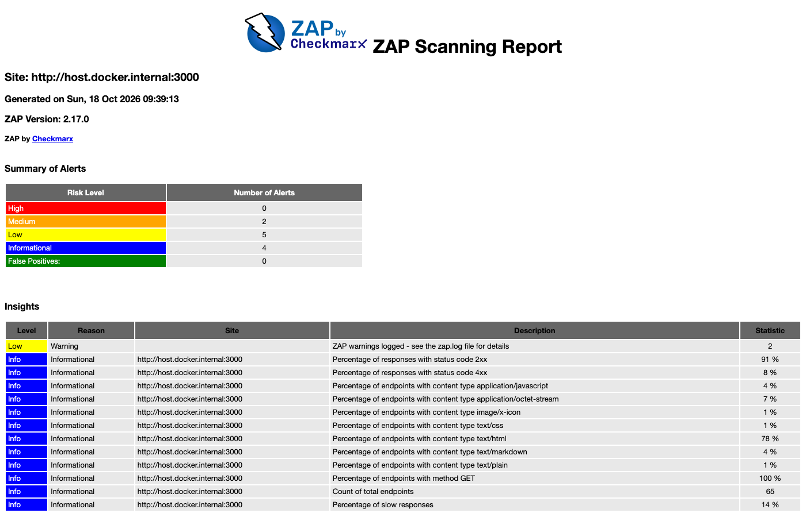
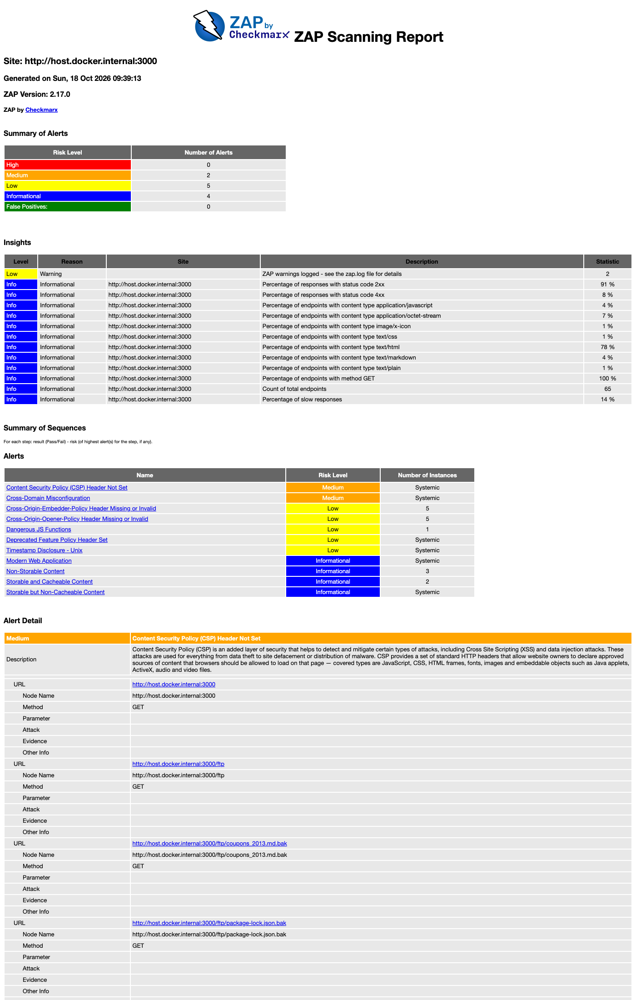

# Анализ уязвимостей веб-приложения с помощью OWASP ZAP

Учебный проект по дисциплине «Информационная безопасность», работа 4.

**Публичный git-репозиторий:** https://github.com/semchik200001/lab4-zap-scan

Динамический анализ защищённости (DAST) веб-приложения методом «быстрого
сканирования» (Quick Scan) с помощью **OWASP ZAP 2.17.0**. В качестве цели
использован локально развёрнутый учебный полигон **OWASP Juice Shop**.

> **О выборе цели.** В методичке в качестве примера указан `testphp.vulnweb.com`.
> На момент выполнения работы этот внешний сайт был недоступен, а активное
> сканирование чужого хоста без разрешения владельца противоречит закону и этике
> ИБ. Поэтому цель — **локальный Juice Shop на `localhost:3000`**: это легальный,
> подконтрольный и специально предназначенный для обучения уязвимый стенд.

## Стенд

| Компонент | Значение |
|---|---|
| Цель (SUT) | OWASP Juice Shop (`bkimminich/juice-shop`), `http://localhost:3000` |
| DAST-сканер | OWASP ZAP 2.17.0 (Desktop GUI + headless-прогон в Docker) |
| Браузер AJAX-паука | встроенный Firefox (обоснование ниже) |
| Ручная верификация | `curl`, DevTools |
| ОС | macOS, Docker 28.0.1 |

**Почему AJAX-паук идёт через Firefox, а не через рабочий браузер.** Основной
рабочий браузер (Chrome) сознательно не используется: в нём накоплены история,
закладки, авторизованные сессии и кэш. Прогон сканирования через него засорил бы
кэш и историю служебными запросами (пришлось бы потом чистить), а также создал бы
риск отправки запросов на сохранённые в автозаполнении сайты. Встроенный в ZAP
Firefox идёт «из коробки» с уже настроенным прокси (`127.0.0.1:8080`) и доверенным
корневым сертификатом **ZAP Root CA** — это чистое изолированное окружение без
ручной настройки прокси и импорта сертификата.

## Ход работы (Quick Scan)

Сканирование выполнено «быстрым» профилем ZAP (**baseline**: обход сайта пауком +
пассивный анализ ответов), что соответствует пункту задания «Быстрое сканирование».

```bash
# 1. Поднять уязвимое приложение
docker run -d --name juice-shop -p 3000:3000 bkimminich/juice-shop
# проверка: http://localhost:3000  -> HTTP 200

# 2. Quick Scan через ZAP: spider + passive scan, с выгрузкой отчётов
docker run --rm -v "$(pwd)/zap:/zap/wrk/:rw" -t zaproxy/zap-stable zap-baseline.py \
  -t http://host.docker.internal:3000 \
  -r zap-quick-report.html -J zap-quick-report.json -w zap-quick-report.md -I
```

В GUI те же действия: вкладка **Quick Start → Automated Scan**, поле **URL to
attack** = `http://localhost:3000`, галочки **traditional spider** и **ajax spider**
(браузер — Firefox), кнопка **Attack**. Результаты — на вкладке **Alerts**, экспорт
через **Report → Generate Report**.

**Итог скана:** обследовано 65 эндпоинтов, найдено **0 High / 2 Medium / 5 Low /
4 Informational** (0 FAIL / 8 WARN / 59 PASS).




## Найденные уязвимости

Для разбора отобрано **5 уязвимостей разного уровня риска**, обнаруженных ZAP, плюс
одна, подтверждённая вручную (SQL-инъекция). Уровень риска указан самим ZAP, рядом в
скобках — уверенность (confidence).

| # | Уязвимость | Риск (ZAP) | CWE | OWASP Top 10 2021 | Суть |
|---|---|---|---|---|---|
| 1 | Content Security Policy (CSP) Header Not Set | Medium | CWE-693 | A05 Misconfiguration | Нет заголовка `Content-Security-Policy` — браузер не ограничивает источники скриптов, что упрощает эксплуатацию XSS. |
| 2 | Cross-Domain Misconfiguration (CORS) | Medium | CWE-264 | A05 Misconfiguration | Сервер отдаёт `Access-Control-Allow-Origin: *` — любой сторонний сайт может читать ответы приложения. |
| 3 | Dangerous JS Functions | Low | CWE-749 | A03 Injection | В клиентском коде найдены опасные функции (напр. запись в DOM без экранирования) — потенциальный вектор DOM-based XSS. |
| 4 | Timestamp Disclosure - Unix | Low | CWE-497 | A01 Broken Access Control | В ответах утекают Unix-таймстемпы — вспомогательная информация для разведки атакующим. |
| 5 | Cross-Origin-Embedder/Opener-Policy Missing | Low | CWE-693 | A05 Misconfiguration | Отсутствуют заголовки COOP/COEP — окно уязвимо к cross-origin-утечкам (класс Spectre, tabnabbing). |
| 6 | SQL Injection (ручная верификация) | Critical | CWE-89 | A03 Injection | Инъекция в форме входа даёт полный обход аутентификации (см. ниже). |

### Ручная верификация: SQL Injection → обход аутентификации

Автосканер (baseline) не шлёт атакующих запросов, поэтому самую опасную уязвимость —
SQL-инъекцию — подтвердил вручную. В поле e-mail формы входа (`POST
/rest/user/login`) передана строка `' OR 1=1--`. Запрос к БД вырождается в условие,
истинное для первой записи, и сервер выдаёт валидный JWT-токен **администратора**
без знания пароля.


Полный отчёт сканера: [`zap/zap-quick-report.html`](zap/zap-quick-report.html)
(машиночитаемые версии — `.json` и `.md` в том же каталоге).



## Рекомендации по устранению

- **CSP / COOP / COEP:** на уровне сервера выставить заголовки
  `Content-Security-Policy`, `Cross-Origin-Opener-Policy: same-origin`,
  `Cross-Origin-Embedder-Policy: require-corp`.
- **CORS:** заменить `Access-Control-Allow-Origin: *` на белый список доверенных
  доменов; не отдавать чувствительные данные без аутентификации.
- **SQLi:** использовать параметризованные запросы (prepared statements) / ORM,
  никогда не склеивать SQL из пользовательского ввода.
- **DOM / опасные функции:** убрать `eval`/небезопасную запись в DOM, экранировать
  вывод; **Timestamp:** не возвращать технические метки времени клиенту.

## Контрольные вопросы

**1. Чем динамическое тестирование (DAST) отличается от статического (SAST)?**
DAST (ZAP) тестирует уже *запущенное* приложение снаружи, как «чёрный ящик», без
доступа к исходному коду: шлёт запросы и анализирует ответы, поэтому находит то, что
реально проявляется в рантайме (ошибки конфигурации, заголовки, инъекции). SAST
анализирует *исходный код* статически, без запуска приложения, — находит дефекты
раньше (на этапе разработки), но даёт больше ложных срабатываний и не видит проблем
среды выполнения и конфигурации. Подходы дополняют друг друга.

**2. Какие последствия может иметь XSS для пользователя сайта?**
Внедрённый злоумышленником JavaScript исполняется в браузере жертвы от её имени:
кража cookie и токена сессии (угон аккаунта), подмена содержимого страницы (фишинг),
выполнение действий от лица пользователя, кейлоггинг вводимых данных, редирект на
вредоносный ресурс.

**3. Почему для тестирования нельзя использовать реальные коммерческие сайты?**
Активное сканирование — это реальные атакующие запросы, которые могут нарушить работу
сервиса или повредить данные. Без письменного разрешения владельца это неправомерный
доступ к информации (в РФ — ст. 272–274 УК РФ). Тестировать допустимо только свои
системы или специальные учебные полигоны (OWASP Juice Shop, `testphp.vulnweb.com`).

## Структура репозитория

```
lab4-zap-scan/
├── README.md                     # этот отчёт
├── docs/screenshots/             # скриншоты-доказательства
├── zap/
│   ├── zap-quick-report.html     # отчёт ZAP (Quick Scan)
│   └── zap-quick-report.{json,md}# машиночитаемые отчёты ZAP
└── report/                       # отчёт в PDF для сдачи
```
