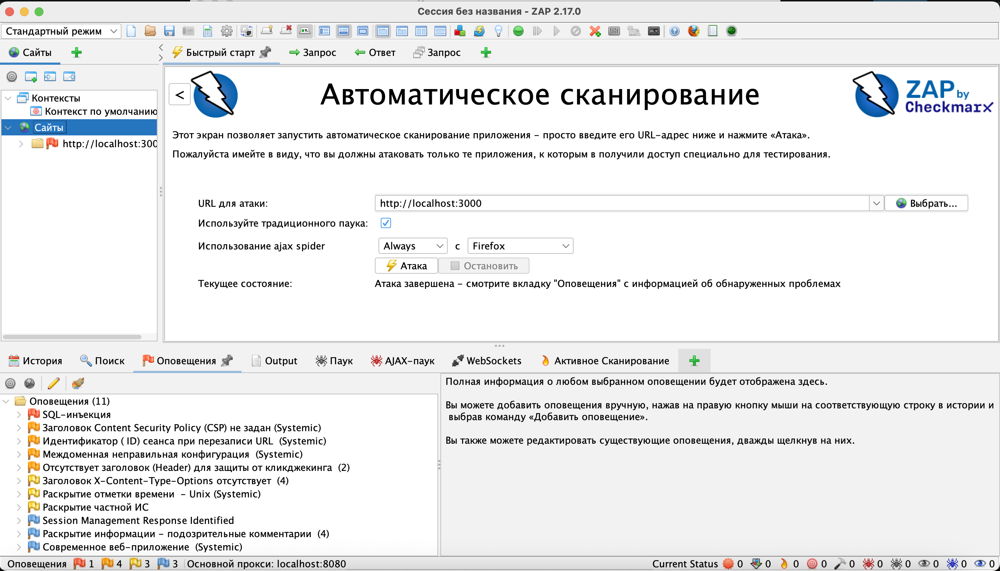
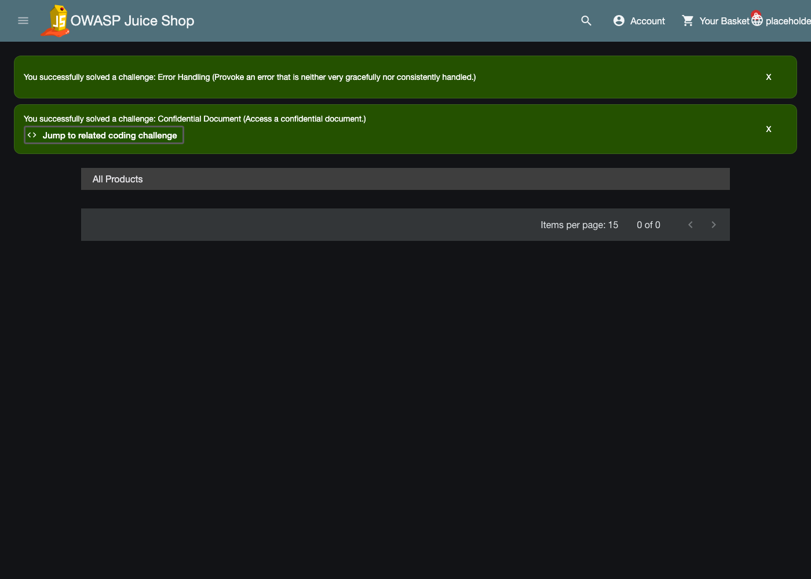
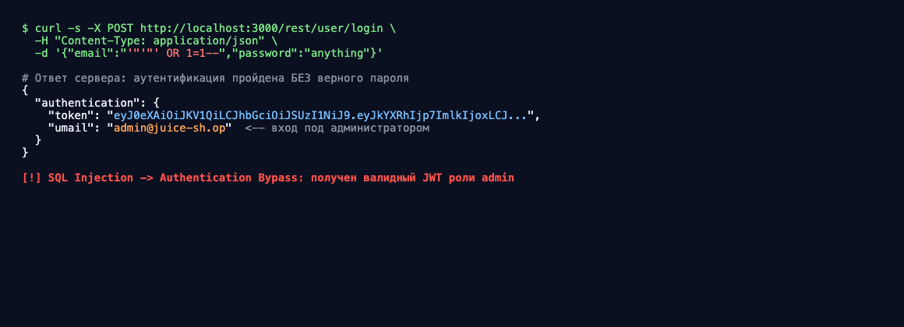
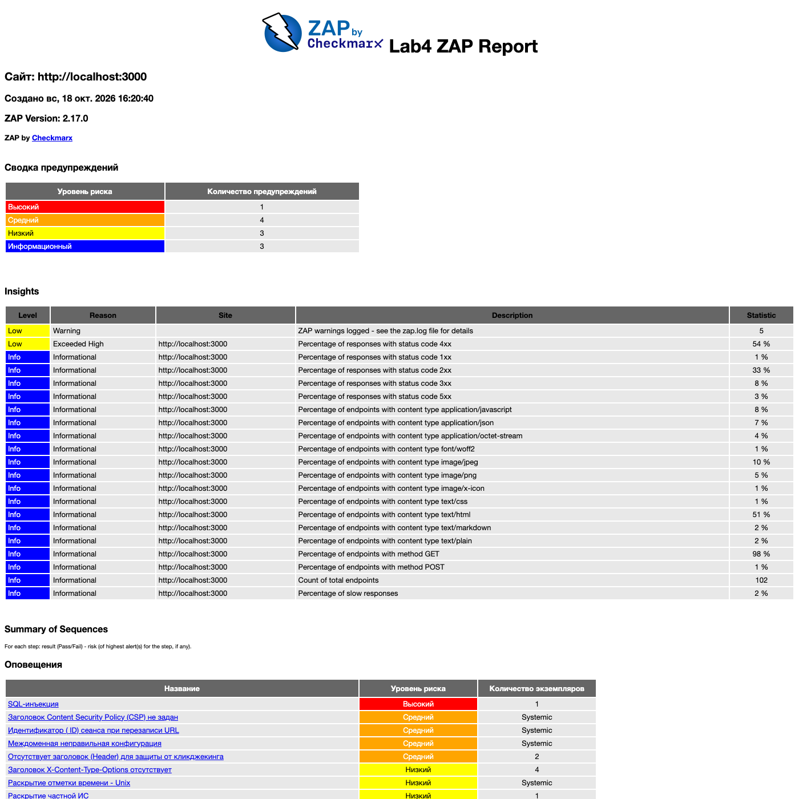

# Анализ уязвимостей веб-приложения с помощью OWASP ZAP

Учебный проект по дисциплине «Информационная безопасность», работа 4.

**Публичный git-репозиторий:** https://github.com/semchik200001/lab4-zap-scan

Динамический анализ защищённости (DAST) веб-приложения методом «быстрого
сканирования» (Quick Scan) с помощью **OWASP ZAP 2.17.0**. В качестве цели
использован локально развёрнутый учебный полигон **OWASP Juice Shop**.

> **О выборе цели.** В методичке в качестве примера указан `testphp.vulnweb.com`.
> На момент выполнения работы этот внешний сайт был недоступен, а активное
> сканирование чужого хоста без разрешения владельца противоречит закону и этике
> ИБ. Поэтому цель — **локальный Juice Shop на `localhost:3000`**: это легальный,
> подконтрольный и специально предназначенный для обучения уязвимый стенд.

## Стенд

| Компонент | Значение |
|---|---|
| Цель (SUT) | OWASP Juice Shop (`bkimminich/juice-shop`), `http://localhost:3000` |
| DAST-сканер | OWASP ZAP 2.17.0 (Desktop GUI + headless-прогон в Docker) |
| Браузер AJAX-паука | встроенный Firefox (обоснование ниже) |
| Ручная верификация | `curl`, DevTools |
| ОС | macOS, Docker 28.0.1 |

**Почему AJAX-паук идёт через Firefox, а не через рабочий браузер.** Основной
рабочий браузер (Chrome) сознательно не используется: в нём накоплены история,
закладки, авторизованные сессии и кэш. Прогон сканирования через него засорил бы
кэш и историю служебными запросами (пришлось бы потом чистить), а также создал бы
риск отправки запросов на сохранённые в автозаполнении сайты. Встроенный в ZAP
Firefox идёт «из коробки» с уже настроенным прокси (`127.0.0.1:8080`) и доверенным
корневым сертификатом **ZAP Root CA** — это чистое изолированное окружение без
ручной настройки прокси и импорта сертификата.

## Ход работы (Quick Scan)

Основное сканирование выполнено «быстрым» профилем в графическом интерфейсе ZAP
(**Быстрый старт → Автоматическое сканирование**): обход сайта традиционным и AJAX-
пауком + пассивный и активный анализ. Это соответствует пункту задания «Быстрое
сканирование». Дополнительно тот же прогон воспроизведён в headless-режиме (Docker)
для выгрузки машиночитаемых отчётов.

```bash
# 1. Поднять уязвимое приложение (первый раз — run, далее — docker start juice-shop)
docker run -d --name juice-shop -p 3000:3000 bkimminich/juice-shop
# проверка: http://localhost:3000  -> HTTP 200

# 2. Тот же скан в headless-режиме для выгрузки отчётов (html/json/md)
docker run --rm -v "$(pwd)/zap:/zap/wrk/:rw" -t zaproxy/zap-stable zap-baseline.py \
  -t http://host.docker.internal:3000 \
  -r zap-quick-report.html -J zap-quick-report.json -w zap-quick-report.md -I
```

В графическом интерфейсе ZAP те же действия: вкладка **«Быстрый старт» →
«Автоматическое сканирование»**, поле **«URL для атаки»** = `http://localhost:3000`,
галочка **«Использовать традиционного паука»** и **«Использование ajax spider»**
(браузер — Firefox), кнопка **«Атака»**. По завершении в строке состояния — «Атака
завершена», результаты на вкладке **«Оповещения»**, экспорт через **«Отчёт → Создать
отчёт»**.

**Итог скана (активный, из GUI):** найдено **11 оповещений** —
**1 High / 4 Medium / 3 Low / 3 Informational**. В отличие от пассивного baseline,
активное сканирование самостоятельно обнаружило **SQL-инъекцию** (High).





## Найденные уязвимости

Активное сканирование дало **11 оповещений**. Для разбора отобрано **5 ключевых**
(включая критическую SQL-инъекцию, которую ZAP нашёл сам). Уровень риска указан самим
сканером.

| # | Уязвимость (как в ZAP) | Риск | CWE | OWASP Top 10 2021 | Суть |
|---|---|---|---|---|---|
| 1 | SQL-инъекция | High | CWE-89 | A03 Injection | Инъекция в форме входа даёт полный обход аутентификации — вход под администратором без пароля (см. ниже). |
| 2 | Заголовок CSP не задан | Medium | CWE-693 | A05 Misconfiguration | Нет заголовка `Content-Security-Policy` — браузер не ограничивает источники скриптов, что упрощает эксплуатацию XSS. |
| 3 | Междоменная неправильная конфигурация (CORS) | Medium | CWE-264 | A05 Misconfiguration | Сервер отдаёт `Access-Control-Allow-Origin: *` — любой сторонний сайт может читать ответы приложения. |
| 4 | Отсутствует заголовок защиты от кликджекинга | Medium | CWE-1021 | A05 Misconfiguration | Нет `X-Frame-Options` / `frame-ancestors` — страницу можно встроить в `<iframe>` и провести clickjacking. |
| 5 | Раскрытие отметки времени — Unix | Low | CWE-497 | A01 Broken Access Control | В ответах утекают Unix-таймстемпы — вспомогательная информация для разведки атакующим. |

Прочие оповещения из скана (Info/Low): идентификатор сессии в URL, отсутствие
`X-Content-Type-Options`, раскрытие частной ИС, подозрительные комментарии в коде,
Session Management Response и признак современного веб-приложения.

### SQL Injection → обход аутентификации (подтверждение вручную)

ZAP пометил SQL-инъекцию как **High**. Дополнительно воспроизвёл её вручную, чтобы
показать реальный эффект: в поле e-mail формы входа (`POST /rest/user/login`) передана
строка `' OR 1=1--`. Запрос к БД вырождается в условие, истинное для первой записи, и
сервер выдаёт валидный JWT-токен **администратора** без знания пароля.



## Экспорт отчёта ZAP

Отчёт выгружен из графического интерфейса ZAP (**Отчёт → Создать отчёт → Traditional
HTML Report**) — файл [`zap/zap-gui-report.html`](zap/zap-gui-report.html). В нём —
сводка рисков (1 Высокий / 4 Средних / 3 Низких / 3 Информационных) и полный список
оповещений с SQL-инъекцией уровня «Высокий» во главе.



Также приложен отчёт headless-прогона: [`zap/zap-quick-report.html`](zap/zap-quick-report.html)
(машиночитаемые версии — `.json` и `.md` в том же каталоге).

## Рекомендации по устранению

- **SQLi:** использовать параметризованные запросы (prepared statements) / ORM,
  никогда не склеивать SQL из пользовательского ввода — это закрывает самую опасную
  (High) находку.
- **CSP:** выставить заголовок `Content-Security-Policy`, ограничив источники скриптов.
- **CORS:** заменить `Access-Control-Allow-Origin: *` на белый список доверенных
  доменов; не отдавать чувствительные данные без аутентификации.
- **Кликджекинг:** добавить `X-Frame-Options: DENY` (или CSP `frame-ancestors`), чтобы
  страницу нельзя было встроить в чужой `<iframe>`.
- **Timestamp / раскрытие информации:** не возвращать технические метки времени и
  отладочные комментарии клиенту.

## Контрольные вопросы

**1. Чем динамическое тестирование (DAST) отличается от статического (SAST)?**
DAST (ZAP) тестирует уже *запущенное* приложение снаружи, как «чёрный ящик», без
доступа к исходному коду: шлёт запросы и анализирует ответы, поэтому находит то, что
реально проявляется в рантайме (ошибки конфигурации, заголовки, инъекции). SAST
анализирует *исходный код* статически, без запуска приложения, — находит дефекты
раньше (на этапе разработки), но даёт больше ложных срабатываний и не видит проблем
среды выполнения и конфигурации. Подходы дополняют друг друга.

**2. Какие последствия может иметь XSS для пользователя сайта?**
Внедрённый злоумышленником JavaScript исполняется в браузере жертвы от её имени:
кража cookie и токена сессии (угон аккаунта), подмена содержимого страницы (фишинг),
выполнение действий от лица пользователя, кейлоггинг вводимых данных, редирект на
вредоносный ресурс.

**3. Почему для тестирования нельзя использовать реальные коммерческие сайты?**
Активное сканирование — это реальные атакующие запросы, которые могут нарушить работу
сервиса или повредить данные. Без письменного разрешения владельца это неправомерный
доступ к информации (в РФ — ст. 272–274 УК РФ). Тестировать допустимо только свои
системы или специальные учебные полигоны (OWASP Juice Shop, `testphp.vulnweb.com`).

## Структура репозитория

```
lab4-zap-scan/
├── README.md                     # этот отчёт
├── docs/screenshots/             # скриншоты-доказательства
├── zap/
│   ├── zap-gui-report.html       # отчёт, выгруженный из GUI ZAP (основной)
│   ├── zap-quick-report.html     # отчёт headless-прогона (Quick Scan)
│   └── zap-quick-report.{json,md}# машиночитаемые отчёты ZAP
└── report/                       # отчёт в PDF для сдачи
```
